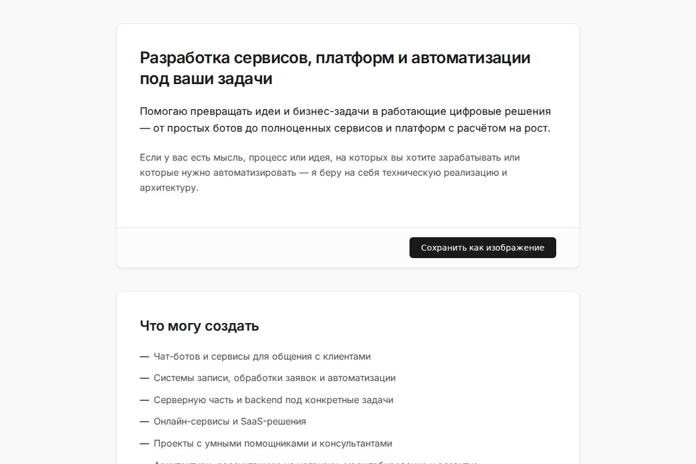

# Генератор карточек и Сайт-визитка



Проект представляет собой интерактивный сайт-визитку с функцией генерации контента для социальных сетей. Основная задача — предоставить удобный интерфейс для чтения информации об услугах и мгновенного экспорта отдельных блоков в формате **1:1 (квадрат)** для Instagram, VK, Avito и других платформ.

## ✨ Возможности

*   **Минималистичный дизайн**: Чистый стиль, вдохновленный эстетикой OpenAI/Inter font.
*   **Генерация изображений**: Каждая секция сайта имеет кнопку "Сохранить как изображение".
*   **Формат 1:1**: Скрипт автоматически трансформирует контент блока в идеальный квадрат 1080x1080px, центрирует текст и увеличивает шрифты для читаемости на мобильных устройствах.
*   **Диаграмма**: Визуализация процесса работы (Идея → Рабочий сервис).

## 🛠 Технологии и Методология

### Архитектура
Проект построен на **Flask** (Python) для серверной части, но основная магия происходит на фронтенде.

1.  **Backend (Flask)**:
    *   Служит для отдачи статики и шаблонов.
    *   Легковесный, легко разворачивается на любом хостинге (Vercel, Railway, VPS).

2.  **Frontend (HTML/CSS)**:
    *   Используется шрифт **Inter** для современной типографики.
    *   CSS Variables для легкой смены цветовой темы.
    *   Верстка адаптивная, но для экспорта используется отдельный набор стилей.

3.  **Экспорт (JS + html2canvas)**:
    *   Мы не генерируем картинки на сервере. Вместо этого используется библиотека `html2canvas`.
    *   **Методология "Shadow Render"**: При клике на кнопку контент клонируется в скрытый контейнер (`.export-frame`), к которому применяются специальные стили (фиксированный размер 1080px, огромные шрифты, центрирование).
    *   Этот скрытый контейнер рендерится в Canvas, а затем скачивается как PNG.
    *   Это гарантирует, что картинка всегда будет идеального качества и пропорций, независимо от того, с какого устройства зашел пользователь.

## 🚀 Запуск проекта

Для запуска локально вам понадобится Python 3 и [Poetry](https://python-poetry.org/).

1.  **Установите зависимости**:
    ```bash
    poetry install
    ```

2.  **Запустите сервер**:
    ```bash
    poetry run python app.py
    ```

3.  **Откройте в браузере**:
    Перейдите по адресу `http://127.0.0.1:5000`

## 🎨 Кастомизация

Все стили находятся в `static/style.css`.
*   `.card` — стили отображения на сайте.
*   `.export-frame` — стили для экспортируемой картинки.

Изменяя `.export-frame`, вы можете полностью поменять дизайн генерируемых карточек, не затрагивая основной вид сайта.
